# gitbonsai

Grow a Japanese maple bonsai from your GitHub activity: an animated SVG for your profile README.

<p align="center">
  <picture>
    <source media="(prefers-color-scheme: dark)" srcset="assets/veteran-legend-dark.svg" />
    
  </picture>
</p>

The tree is yours: it grows from your own GitHub activity, week by week. The trunk rises with the years you've been active and thickens with every contribution you've ever made. Each language you write grows branches on its own side, with leaves in that language's color. Your last few months decide how full the leaves are, so busy stretches show and quiet ones thin the crown. Wood never shrinks, so the tree remembers everything.

| Veteran | Comeback | Newbie |
| :---: | :---: | :---: |
| <picture><source media="(prefers-color-scheme: dark)" srcset="assets/veteran-dark.svg" /></picture> | <picture><source media="(prefers-color-scheme: dark)" srcset="assets/comeback-dark.svg" /></picture> | <picture><source media="(prefers-color-scheme: dark)" srcset="assets/newbie-dark.svg" /></picture> |
| 16 years, busy since 2023 | quiet for two years, then back | one year in |

<details>
<summary>What every part shows</summary>

| What you see | What it shows |
| --- | --- |
| Height | Age, from your first sustained activity |
| Girth | Every contribution ever, flowing down the branches |
| Branches | One side of the tree per language; your top language feeds the crown |
| Leaf color | The language, on the Japanese maple palette |
| Leaf density | Your last 13 weeks |
| Bronze tips | New growth from last week |
| Bare wood | A language unused for 13 weeks |
| Bleached deadwood | A language silent for a year |
| Winged seeds | Your lifetime level |
| Falling leaves | You crossed a level this week |
| Moss | Your current weekly streak |
| The pot | Your longest streak |

</details>

## Use it

Needs the [GitHub CLI](https://cli.github.com), logged in.

```sh
cargo install gitbonsai
gitbonsai collect <login> --output me.snapshot.json
gitbonsai render me.snapshot.json     # bonsai/: light and dark SVG, PNG, preview.html
gitbonsai explain me.snapshot.json    # every number behind the tree
```

On your profile, copy [examples/profile-workflow.yml](examples/profile-workflow.yml) to `.github/workflows/bonsai.yml` in `<you>/<you>`. It regrows the tree every week. Then add this to your README:

```html
<p align="center">
  <picture>
    <source media="(prefers-color-scheme: dark)" srcset="assets/bonsai-dark.svg" />
    
  </picture>
</p>
```

On its own, `width="600"` suits a desktop column, and phones scale it down to fit. Next to other cards, use `400`.

Styles, leaf colors, the pot glaze and an optional legend (left or right of the tree) go in a `bonsai.toml`; see [examples/bonsai.toml](examples/bonsai.toml).

## Credits

Growth is space colonization (Runions, Lane and Prusinkiewicz, 2007). Inspired by [git-koi](https://github.com/yalongwastaken/git-koi).

## License

[MIT](LICENSE-MIT) or [Apache-2.0](LICENSE-APACHE), at your option.
