# gitbonsai

Grow a Japanese maple bonsai from your GitHub activity: an animated SVG for your profile README.

**[gitbonsai.dev](https://gitbonsai.dev)**: watch trees grow, and preview your own.

<p align="center">
  <picture>
    <source media="(prefers-color-scheme: dark)" srcset="assets/showcase-legend-dark.svg" />
    
  </picture>
</p>

A newcomer is a thin sprout; years of work make it short, thick and wide, the way a prize bonsai is. Your first language is the trunk; another that reaches a tenth of your work claims a strand of it, and the languages of your recent years share the crown, each in its color. Nothing is erased: the tree changes a little each month, and its trunk only grows.

Unless you set a style, your last three years mostly pick the shape: steady work in one language grows a formal upright (chokkan), new languages an informal upright (moyogi), pauses a slanting tree (shakan), pauses with several languages a windswept one (fukinagashi), and steady work in a classic language such as COBOL or Fortran a semi-cascade (han-kengai) whose trunk turns white while it keeps growing.

<p align="center">
  <picture>
    <source media="(prefers-color-scheme: dark)" srcset="assets/row-top-dark.svg" />
    
  </picture>
  <picture>
    <source media="(prefers-color-scheme: dark)" srcset="assets/row-bottom-dark.svg" />
    
  </picture>
</p>

From top left:

- **Sprout** (simulated): three days and 12 contributions in, its seed leaves still open.
- **Newcomer**: the same account a few months in, a thin seedling.
- **[@jacobwilliams](https://github.com/jacobwilliams)**: 13 years, mostly Fortran; a semi-cascade over the rim, its Fortran trunk white and still growing.
- **[@StevenBtw](https://github.com/StevenBtw)**: 9 years of Python and Rust; quiet summers swept it windswept.
- **[@tj](https://github.com/tj)**: 19 years; long pauses slant it, and resting since 2021, bare for the winter.
- **[@torvalds](https://github.com/torvalds)**: 16 years of C every week; a thick formal upright.
- **[@steipete](https://github.com/steipete)**: 17 years; new languages on new strands, its crown starting to bend downwind.

The five real trees are grown from their public GitHub activity with `gitbonsai collect <login>` and `gitbonsai render`. Look closely: a tree may hide a few small surprises of its own.

<details>
<summary>What every part shows</summary>

| What you see | What it shows |
| --- | --- |
| The trunk | Your first language; it only grows |
| Strands | Each language with at least 10% of your work; it comes away from the trunk the more you use it |
| Girth | Every contribution ever, and your age |
| The crown | Your last three to six years, a sector per language with a real share of them |
| Low limbs | Earlier eras, oldest lowest |
| A gap of bare trunk | A long pause before your recent years |
| Leaf color | The language, on the Japanese maple palette |
| Silver leaves | Private work; only when your profile includes private contributions (Settings, Public profile); their tips take your public languages' colors, encouraging open source work |
| Fullness | How busy your recent years were; old leaves thin out |
| Bronze tips | New growth from last week |
| Bleached deadwood | A language you stopped using while you kept working; it dies in place and weathers over the years |
| A bleached strip up the trunk | The language your tree started with, dropped |
| A bare tree | A year without contributions: resting for the winter |
| Winged seeds | Your lifetime level |
| Falling leaves | You crossed a level this week |
| Moss | Your current weekly streak |
| The pot | Your longest streak |
| The shape | Mostly your last three years: steady, new languages, pauses, or a classic language |
| A white trunk | A classic language such as COBOL or Fortran, still growing |

</details>

## Use it on your profile

Add the action to a weekly workflow in your profile repository (`<you>/<you>`); [examples/profile-workflow.yml](examples/profile-workflow.yml) is a complete one to copy to `.github/workflows/bonsai.yml`:

```yaml
- uses: StevenBtw/gitbonsai@v0.5.2
  with:
    output-dir: assets   # bonsai-light.svg and bonsai-dark.svg
    legend: left         # optional: off (default), left or right
```

Then add this to your README:

```html
<p align="center">
  <picture>
    <source media="(prefers-color-scheme: dark)" srcset="assets/bonsai-dark.svg" />
    
  </picture>
</p>
```

On its own, `width="600"` suits a desktop column, and phones scale it down to fit. Next to other cards, use `400`.

The action keeps `bonsai.snapshot.json` beside the SVGs; the example workflow commits it, so each run fetches only the last few months. It is public like the SVGs. After turning private contributions on or off in your profile, run once with `full: true` to fetch the whole history again.

Styles, leaf colors, the pot glaze and the legend go in a `bonsai.toml`, and so does `hemisphere = "south"` if the seasons should follow the southern hemisphere; see [examples/bonsai.toml](examples/bonsai.toml). The action reads it from the repository root, and its inputs `style` and `legend` override it.

## Run it locally

Needs the [GitHub CLI](https://cli.github.com), logged in.

```sh
cargo install gitbonsai --locked
gitbonsai collect <login> --output me.snapshot.json
gitbonsai render me.snapshot.json     # bonsai/: light and dark SVG, PNG, preview.html
gitbonsai explain me.snapshot.json    # every number behind the tree
```

A change to how trees look updates the gallery reference, which CI checks: `scripts/gallery-hashes.sh > gallery.sha256`.

## Credits

The tree is shaped after exhibition Japanese maples. Inspired by [git-koi](https://github.com/yalongwastaken/git-koi).

## License

[MIT](LICENSE-MIT) or [Apache-2.0](LICENSE-APACHE), at your option.
