# gitbonsai

Grow a Japanese maple bonsai from your GitHub activity: an animated SVG for your profile README.

<p align="center">
  <picture>
    <source media="(prefers-color-scheme: dark)" srcset="assets/veteran-dark.svg" />
    
  </picture>
</p>

Height is your age on GitHub, girth is every contribution you ever made, each language grows its own branches and leaf color, and your last few months decide how full the leaves are. Wood never shrinks.

## Use it

Needs the [GitHub CLI](https://cli.github.com), logged in.

```sh
cargo install gitbonsai
gitbonsai collect <login> --output me.snapshot.json
gitbonsai render me.snapshot.json     # bonsai/: light and dark SVG, PNG, preview.html
gitbonsai explain me.snapshot.json    # every number behind the tree
```

On your profile, copy [examples/profile-workflow.yml](examples/profile-workflow.yml) to `.github/workflows/bonsai.yml` in `<you>/<you>`. It regrows the tree every week. Then add this to your README:

```html
<p align="center">
  <picture>
    <source media="(prefers-color-scheme: dark)" srcset="assets/bonsai-dark.svg" />
    
  </picture>
</p>
```

Styles, leaf colors and the pot glaze go in a `bonsai.toml`; see [examples/bonsai.toml](examples/bonsai.toml).

## Credits

Growth is space colonization (Runions, Lane and Prusinkiewicz, 2007). Inspired by [git-koi](https://github.com/yalongwastaken/git-koi).

## License

[MIT](LICENSE-MIT) or [Apache-2.0](LICENSE-APACHE), at your option.
