# gitbonsai

Grow a Japanese maple bonsai from your GitHub activity: an animated SVG for your profile README.

<p align="center">
  <picture>
    <source media="(prefers-color-scheme: dark)" srcset="assets/showcase-legend-dark.svg" />
    
  </picture>
</p>

The tree is yours: it grows from your own GitHub activity. A newcomer is a thin sprout; years of work make it short, thick and wide, the way a prize bonsai is, never tall. A language that becomes a real part of your work claims a strand of the trunk, which comes away as a trunk of its own the more you use it, and each language in your recent years owns part of the crown, in its color. The crown is your last few years; older years sit lower as limbs, and a long pause leaves a gap of bare trunk. Private work shows as silver leaves, if your profile shares it, their tips taking your public languages' colors. A language you've dropped dies where it grew and weathers slowly, and a year without contributions leaves the tree bare for the winter. The tree changes a little each month, never all at once: nothing is erased, and its trunk only grows.

<p align="center">
  <picture>
    <source media="(prefers-color-scheme: dark)" srcset="assets/row-dark.svg" />
    
  </picture>
</p>

From left:

- **Newbie** (simulated); a few months in, two languages: a thin sprout in its first pot.
- **[@StevenBtw](https://github.com/StevenBtw)**: around 9 years; mainly Python and Rust, Rust coming away from the trunk on its own strand; recently picked up TypeScript.
- **[@tj](https://github.com/tj)**: around 19 years; JavaScript, later Go; resting since 2021, so bare for the winter, its dropped languages weathering in place.
- **[@torvalds](https://github.com/torvalds)**: around 16 years of C, every single week; one steady trunk.
- **[@steipete](https://github.com/steipete)**: around 17 years; a recent burst of work, its newer languages coming away from the trunk on their own strands.

The four real trees are grown from their public GitHub activity with `gitbonsai collect <login>` and `gitbonsai render`. Look closely: a tree may hide a few small surprises of its own.

<details>
<summary>What every part shows</summary>

| What you see | What it shows |
| --- | --- |
| The trunk | Your first language; it only grows |
| Strands | Each language with at least 10% of your work; it comes away from the trunk the more you use it |
| Girth | Every contribution ever, and your age |
| The crown | Your last three to six years, a sector per language with a real share of them |
| Low limbs | Earlier eras, oldest lowest |
| A gap of bare trunk | A long pause before your recent years |
| Leaf color | The language, on the Japanese maple palette |
| Silver leaves | Private work; only when your profile includes private contributions (Settings, Public profile); their tips take your public languages' colors |
| Fullness | How busy your recent years were; old leaves thin out |
| Bronze tips | New growth from last week |
| Bleached deadwood | A language you stopped using while you kept working; it dies in place and weathers over the years |
| A bleached strip up the trunk | The language your tree started with, dropped |
| A bare tree | A year without contributions: resting for the winter |
| Winged seeds | Your lifetime level |
| Falling leaves | You crossed a level this week |
| Moss | Your current weekly streak |
| The pot | Your longest streak |

</details>

## Use it on your profile

Add the action to a weekly workflow in your profile repository (`<you>/<you>`); [examples/profile-workflow.yml](examples/profile-workflow.yml) is a complete one to copy to `.github/workflows/bonsai.yml`:

```yaml
- uses: StevenBtw/gitbonsai@v0.3.0
  with:
    output-dir: assets   # bonsai-light.svg and bonsai-dark.svg
    legend: left         # optional: off (default), left or right
```

Then add this to your README:

```html
<p align="center">
  <picture>
    <source media="(prefers-color-scheme: dark)" srcset="assets/bonsai-dark.svg" />
    
  </picture>
</p>
```

On its own, `width="600"` suits a desktop column, and phones scale it down to fit. Next to other cards, use `400`.

The action keeps `bonsai.snapshot.json` beside the SVGs; the example workflow commits it, so each run fetches only the last few months. It is public like the SVGs. After turning private contributions on or off in your profile, run once with `full: true` to fetch the whole history again.

Styles, leaf colors, the pot glaze and the legend go in a `bonsai.toml`; see [examples/bonsai.toml](examples/bonsai.toml). The action reads it from the repository root, and its inputs `style` and `legend` override it.

## Run it locally

Needs the [GitHub CLI](https://cli.github.com), logged in.

```sh
cargo install gitbonsai --locked
gitbonsai collect <login> --output me.snapshot.json
gitbonsai render me.snapshot.json     # bonsai/: light and dark SVG, PNG, preview.html
gitbonsai explain me.snapshot.json    # every number behind the tree
```

A change to how trees look updates the gallery reference, which CI checks: `scripts/gallery-hashes.sh > gallery.sha256`.

## Credits

The tree is shaped after exhibition Japanese maples. Inspired by [git-koi](https://github.com/yalongwastaken/git-koi).

## License

[MIT](LICENSE-MIT) or [Apache-2.0](LICENSE-APACHE), at your option.
